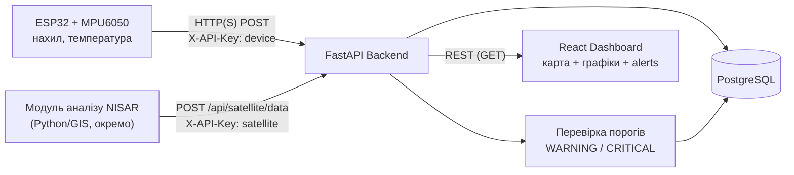

# KORA — архітектура

## Принципи

- **Бекенд не обробляє сирі SAR-знімки.** Він приймає лише готовий результат аналізу (зміщення, дата, геометрія).
- **Попередження — індикатори для перевірки,** а не висновок про аварійність будівлі.
- **Мало даних → `UNKNOWN`,** а не `NORMAL`.
- Запис захищений ключами (`X-API-Key`) трьох рівнів: admin, device, satellite. Читання відкрите для дашборду.
- Усі безкоштовні компоненти: FastAPI, PostgreSQL (Neon/Supabase/локально), Render free, Vercel free, OpenStreetMap, Leaflet.

## Потік даних

1. ESP32 раз на ~30 с шле `{sensor_id, tilt_x, tilt_y, temperature, timestamp}`.
2. Бекенд валідує дані (Pydantic), перевіряє існування датчика, зберігає вимірювання.
3. Нахил порівнюється з порогами → створюється alert (без дублікатів активних).
4. Супутниковий модуль шле `{object_id, displacement, unit, observation_date, geometry, source}`. Зміщення переводиться в мм і порівнюється з порогами.
5. Дашборд кожні 15 с читає `/api/objects/{id}/status`, `/api/sensors/{id}/data`, `/api/satellite/map`, `/api/alerts`.

## Статус об'єкта

| Умова | Статус |
|---|---|
| Немає ні вимірювань, ні супутникових даних | `UNKNOWN` |
| Є дані, активних alerts немає | `NORMAL` |
| Найвищий активний alert — WARNING | `WARNING` |
| Найвищий активний alert — CRITICAL | `CRITICAL` |

## Пороги (налаштовуються в `.env`)

| Параметр | WARNING | CRITICAL |
|---|---|---|
| Нахил (по модулю, градуси) | > 2 | > 5 |
| Супутникове зміщення (по модулю, мм) | > 10 | > 25 |

Значення за замовчуванням обрані командою для демо і потребують калібрування під реальні об'єкти.
